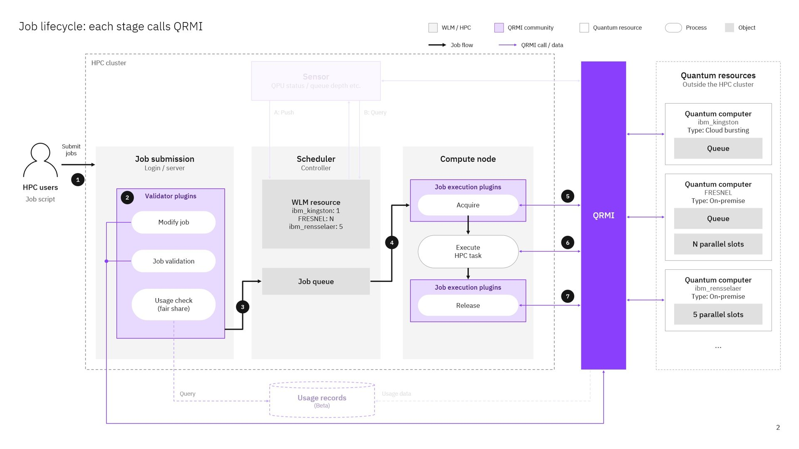

<a href="https://qrmi-community.github.io/tutorials/sc26/">
  
</a>

[](https://opensource.org/licenses/Apache-2.0) <!--- long-description-skip-begin -->
[](https://github.com/qiskit-community/qrmi/releases)

[](https://doi.org/10.5281/zenodo.23691145)


> [!IMPORTANT]
> **Tutorial preparation for November 16, 2026.** In the batch-scheduler hands-on you
> choose **one workload manager** and **one quantum provider**, and follow only
> their parts. You install and run one cluster on your laptop; the guides show
> all four workload managers side by side so that you can compare them, but you
> skip the parts for the other three. The
> [terminology reference](hands-on/GLOSSARY.md) explains unfamiliar terms.

## 1. Choose your workload manager

Clone this repository, set up the
containers of your workload manager from its `containers/<workload manager>`
directory, then install QRMI in **Module 1**.

| Workload manager | Containers | Module 1: install QRMI |
| --- | --- | --- |
| Slurm | [containers/slurm](containers/slurm/docs/INSTALL.md) | [Slurm Module 1](hands-on/module-1/slurm/INSTALL.md) |
| OpenPBS | [containers/openpbs](containers/openpbs/docs/INSTALL.md) | [OpenPBS Module 1](hands-on/module-1/openpbs/INSTALL.md) |
| LSF | [containers/lsf](containers/lsf/docs/INSTALL.md) | [LSF Module 1](hands-on/module-1/lsf/INSTALL.md) |
| Open Cluster Scheduler (OCS) | [containers/ocs](containers/ocs/docs/INSTALL.md) | [OCS Module 1](hands-on/module-1/ocs/INSTALL.md) |

Each Module 1 starts the cluster with the add-ons of all providers and then
configures QRMI for the provider you choose below.

## 2. Choose your quantum provider

Do the provider's onboarding before the session, then work through Modules 2–4
as an HPC user.

| Provider | Onboarding | Module 2: lower-level QRMI API | Module 3: high-level SDK | Module 4 (optional): MPI |
| --- | --- | --- | --- | --- |
| Pasqal | [Pasqal Cloud onboarding](onboarding/pasqal-cloud-onboarding.md) | [Pasqal Module 2](hands-on/module-2/pasqal/README.md) | [Pulser](hands-on/module-3/pasqal/README.md) | [MPI post-processing](hands-on/module-4/pasqal/README.md) |
| IBM | [IBM Quantum onboarding](onboarding/ibm-quantum-onboarding.md) | [IBM Module 2](hands-on/module-2/ibm/README.md) | [Qiskit Sampler](hands-on/module-3/ibm/README.md) | [MPI post-processing](hands-on/module-4/ibm/README.md) |
| Alice & Bob (Slurm only) | [Alice & Bob onboarding](onboarding/alice-bob.md) | [Alice & Bob Module 2](hands-on/module-2/alice-bob/README.md) | [Qiskit Sampler](hands-on/module-3/alice-bob/README.md) | — |

What each module achieves:

- **Module 1:** a batch job whose scheduler hooks acquire and release the quantum resource.
- **Module 2:** submit a backend-specific payload (for Pasqal, a serialized pulse sequence; for IBM, a Bell circuit; for Alice & Bob, a QIR program) through the QRMI task API and retrieve the counts.
- **Module 3:** build and run the same kind of program with the provider's SDK (Pulser, Qiskit's Sampler) through QRMI.
- **Observe the integration (after Module 2):** see the scheduler hold, cancel and release the resource, and follow one job into the backend's records ([exercise](hands-on/module-1/OBSERVE.md)).
- **Module 4, optional:** pass quantum results to a standard MPI program, run by the same workload manager.

Create your provider account and build your workload manager's containers
before the session. Module 4 is for participants who finish early. Pasqal
exercises run on Pasqal Cloud's `EMU_FREE` emulator, with a local Warden backup
that needs no network. IBM exercises can use the local IBM Quantum System API
emulator when you have no IBM account. Alice & Bob exercises run on the Felis
emulators. Other providers and the Kubernetes and Flux parts of the tutorial
have their own sessions and materials.

## 3. One pattern, four workload managers

The tracks follow a common architecture, shown below as seven stages. Each
integration implements a different subset of the checks and scheduling controls;
the table below maps them to your workload manager. The purple boxes are
extensions built by the QRMI community:

<p align="center">
  
</p>

1. The user submits a job script that names a quantum resource.
2. Where installed, **validator plugins** check the request at submission.
3. The scheduler uses the configured **WLM resource** to decide when the job
   can start. A **sensor** can feed QRMI status into that decision by pushing
   updates or answering queries. LSF checks availability after dispatch and
   requeues unavailable work instead.
4. The scheduler starts the job on a compute node.
5. A **job execution plugin** calls QRMI to acquire the quantum resource.
6. Your program runs and sends its quantum tasks through QRMI.
7. A job execution plugin calls release during cleanup. Cancellation handling
   and cleanup after failures depend on the integration and backend.

Scheduler counters limit allocations within that scheduler; a readiness check
reports availability without reserving it. What acquire does depends on the
provider: some open a session (IBM Quantum batch sessions, Pasqal's Warden),
others do nothing (Pasqal Cloud, Alice & Bob). A scheduler license therefore
does not reserve a physical cloud QPU. Cancelling a batch job, releasing a
session and stopping a remote quantum task are separate operations; check the
backend's task state to confirm cancellation.

The quantum resources on the right are examples: a cloud QPU, and on-premise
QPUs that run several jobs in parallel (slots). In the exercises a job
requests one resource. The scheduler integrations differ as follows (you
install only your own workload manager's column; the others are for comparison):

| Part of the pattern | Slurm | OpenPBS | OCS | LSF |
| --- | --- | --- | --- | --- |
| Request in the job | `--qpu=<name>` and `--licenses=<name in lowercase>@slurmdb:1` | `-l quantum_resources=<name>` | `-q qpu.q -l qpu=<name>` | `QRMI_QPU_RESOURCES=<name> bsub` |
| Validator plugins | job submit plugin: `--qpu` needs its license | `qrmi_validate` hook | — | — |
| WLM resource | license | custom resource (`qrmi_<name>` counter) | complexes `qpu`, `qpu_ready` | — |
| Sensor | license poller daemon, pushes (static license for `PASQAL_LOCAL`) | `qrmi_check` hook, queries before the job starts | load sensor `qpu_ready`, for Warden | `JOB_STARTER` checks and requeues the job |
| Job execution plugins: acquire and release | QRMI SPANK plugin | `qrmi_acquire`, `qrmi_launch`, `qrmi_release` hooks | queue prolog and epilog | `JOB_STARTER`; Pasqal Local: `PRE_EXEC`/`POST_EXEC` |

Your program in Modules 2–4 is the same on every workload manager: it reads the
resource the plugin acquired and calls the QRMI task API. Each Module 1 ends with
a checkpoint on these parts for your workload manager.

## 4. Before the session

Do these at home, with a good network, so that the session is spent on the
exercises. Prepare only your workload manager's row:

| Workload manager | Prepare | Ready when |
| --- | --- | --- |
| Slurm | Build and start the cluster with the add-ons (Module 1, steps 1–2). Optionally run Module 1 steps 5–8, which download and compile the SPANK plugin (the largest download of the session); in the session you continue with step 9. | the check below passes, and `/shared/spank-plugins/plugins/spank_qrmi/build/spank_qrmi.so` exists if you did steps 5–8 |
| OpenPBS | Build the base image and the add-ons, and start the cluster (Module 1, prerequisites). | the check below passes |
| LSF | Download LSF Community Edition into `containers/lsf/shared`, build and start the cluster once (its first start installs LSF). | the check below passes and `bhosts` lists the compute nodes |
| OCS | Build the images, including the tutorial images ([container guide](containers/ocs/docs/INSTALL.md#1-building-the-containers)). | the check below passes |

The builds need a good network and take 10 to 30 minutes; don't leave them for
the session. Check, on the host in `containers/<your workload manager>`:

```bash
docker image inspect $(docker compose <-f list> config --images) > /dev/null && echo "all images present"
```

with `<-f list>` for your workload manager, or the list you started the cluster
with if you left out an add-on:

| Workload manager | `<-f list>` |
| --- | --- |
| Slurm | `-f compose.yml -f compose.ibm.yml -f compose.warden.yml` |
| OpenPBS | `-f compose.yaml -f compose.ibm.yaml -f compose.warden.yaml` |
| LSF | `-f compose.yaml -f compose.ibm.yaml -f compose.warden.yaml` |
| OCS | `-f compose.yaml -f compose.qrmi.yaml -f compose.warden.yaml -f compose.ibm.yaml` |

For every provider: create your account (see the onboarding) and keep the
values for the credentials step at hand.

## 5. Take it to your site

After the hands-on, use what you saw to answer these for your own site:

- Which credentials belong to the site, and which to each user? (In most
  tracks, IBM and Alice & Bob API keys sit in the root-only QRMI configuration,
  and Pasqal Cloud accounts in the users' home directories.)
- What does your scheduler count for a quantum resource, and who else can use
  the backend outside the scheduler? (A license or counter limits only the
  scheduler's own jobs.)
- Which components need outbound network access: the nodes running jobs, the
  head node running a sensor, or both?
- What evidence connects a scheduler job to the provider's usage records? (For
  example, Warden records the job ID and user with each session.)
- What happens after a timeout, a cancellation or a compute-node failure: is the
  session released, and is the remote task stopped?
- Which of the tutorial's components need a supervised service and a recovery
  procedure at your site (the license poller, Warden, the load sensor)?

Tested platforms are listed in [containers/Test.md](containers/Test.md).
