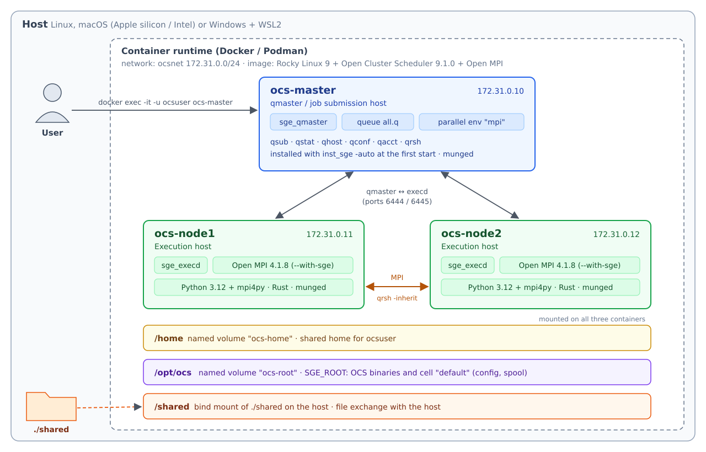

# Installation of Open Cluster Scheduler Cluster Containers

This document describes how to set up a local, container-based Open Cluster Scheduler (OCS) development environment. The environment is intended for developing and testing QRMI and OCS integrations without access to a production HPC cluster.

For the tutorial, build the images as in [section 1](#1-building-the-containers),
including the [tutorial images](#tutorial-images), then follow
[OCS Module 1](../../../hands-on/module-1/ocs/INSTALL.md), which starts the cluster
and configures the hooks. This page is also a reference for cluster
troubleshooting.

## Jump To

- [Container Contents](#container-contents)
- [Prerequisites](#prerequisites)
- [Creating a Docker-based OCS Cluster](#creating-a-docker-based-ocs-cluster)
  - [1. Building the containers](#1-building-the-containers)
  - [2. Starting the cluster](#2-starting-the-cluster)
  - [3. Verifying the cluster](#3-verifying-the-cluster)
  - [4. Stopping and cleaning up](#4-stopping-and-cleaning-up)
- [Slurm to OCS Command Reference](#slurm-to-ocs-command-reference)
- [Image Details](#image-details)
- [Customizing the Cluster](#customizing-the-cluster)
- [Troubleshooting](#troubleshooting)

## Container Contents

All cluster nodes are built from the same base image with the following software stack:

| Component | Version | Notes |
|-----------|---------|-------|
| Base OS   | Rocky Linux 9 | RHEL 9–compatible base image |
| Open Cluster Scheduler | 9.1.7 | Workload manager (`sge_qmaster`, `sge_execd`), binary release from open.clusterscheduler.io |
| Python    | 3.12 | System-wide `python3.12` (also `python3`), used by mpi4py and QRMI |
| MUNGE     | Rocky Linux 9 package | Authentication service, used by QRMI for Pasqal Local (Warden) |
| Open MPI  | 4.1.8   | MPI implementation, built with Grid Engine support (`--with-sge`) |
| mpi4py    | latest at build time | Python 3.12 MPI bindings, built against the bundled Open MPI |
| Rust      | stable at build time | Installed with rustup under `/opt/rust`, available to all users |

The OCS binaries are unpacked into `/opt/ocs` at build time. `/opt/ocs` is a volume shared by all three containers, like the shared `SGE_ROOT` of a real cluster. On its first start, `ocs-master` installs the qmaster and creates the cell directory `/opt/ocs/default`; each execution node then installs and registers its own `sge_execd`. Later starts only start the daemons.

Open MPI is built with Grid Engine support, so `mpirun` inside an OCS parallel job automatically picks up the slots granted by OCS (`$PE_HOSTFILE`) and starts its processes on the other nodes with `qrsh -inherit`. No hostfile, `-np` option or ssh is required.

The OCS daemons are started with the rc scripts in `/opt/ocs/default/common` from the container entrypoint, so systemd is not required inside the containers.

## Prerequisites

A container manager such as one of the following:

- [Docker](https://docs.docker.com/get-docker/)
- [Podman](https://podman.io/getting-started/installation.html)
- [Rancher Desktop](https://rancherdesktop.io/)

> **Note for Podman users:** `docker-compose` must be installed separately. On macOS, install it with:
>
> ```bash
> brew install docker-compose
> ```
>
> On Ubuntu (including WSL2), use Compose v2 through `podman compose`:
>
> ```bash
> sudo apt install --no-install-recommends podman docker-compose-v2
> systemctl --user enable --now podman.socket
> export PODMAN_COMPOSE_PROVIDER=/usr/libexec/docker/cli-plugins/docker-compose
> ```
>
> On both, also set these before building. Compose's default builder cannot see Podman's local images, so an image built on top of another local image (such as the QRMI image) fails with `pull access denied` without them:
>
> ```bash
> export DOCKER_BUILDKIT=0 COMPOSE_DOCKER_CLI_BUILD=0 COMPOSE_BAKE=false
> ```
>
> Add the `export` lines to `~/.bashrc` (`~/.zshrc` on macOS). Don't use Ubuntu's `podman-compose` (1.0.x): it drops the values of `sysctls`, cannot build the local IBM Quantum System API emulator from its Git URL, and does not resolve short image names such as `rustfs/rustfs`. Ubuntu's `docker-compose` package is the old v1.
>
> The build compiles Open MPI from source, so give the Podman machine at least 4 GB of memory:
>
> ```bash
> podman machine stop
> podman machine set --cpus 4 --memory 4096
> podman machine start
> ```

> **Note for Windows (WSL2) users:**
>
> - **Location**: extract and edit the files inside the WSL file system (for example `~/SC26`), not under `/mnt/c`, to avoid permission and performance problems.
> - **Line endings**: files saved by Windows editors may get CRLF line endings, which break shell scripts. `entrypoint.sh` is converted to LF automatically at build time; fix job scripts with `dos2unix *.ocs` before submitting them.
> - **Subnet**: WSL2 itself uses addresses in 172.16–31, which may conflict with `172.31.0.0/24`. If so, see [Changing the network](#changing-the-network).

The image builds natively on both Apple silicon (arm64) and Intel/AMD (x86_64) hosts. An image built on one architecture cannot be reused on the other; build it again on each host.

## Creating a Docker-based OCS Cluster

> **Note for Podman users:** The commands below use the `docker` CLI. With Podman, replace `docker` with `podman`, or define `alias docker=podman`.

### 1. Building the containers

Run the following command from the directory containing `compose.yaml`:

```bash
docker compose build --no-cache ocs-master
docker compose build
```

All three services use the same image. The first command builds it once from scratch; the second tags it for the other services from the cache. Running `docker compose build --no-cache` without a service name compiles the same image three times.

The first build downloads OCS and compiles Open MPI and mpi4py from source, so it may take some time.

The following build arguments can be overridden with `--build-arg`:

| Argument | Default | Description |
|----------|---------|-------------|
| `OCS_VERSION` | `9.1.7` | OCS release downloaded from open.clusterscheduler.io (9.1.6 or later), recorded in `/opt/ocs/OCS_VERSION` |
| `OPENMPI_VERSION` | `4.1.8` | Open MPI version (4.1.x series) |
| `INSTALL_MPI4PY` | `1` | Set to `0` to skip mpi4py |
| `PIP_PACKAGES` | (empty) | Extra Python 3.12 packages, for example `qrmi` |

For example:

```bash
docker compose build --build-arg PIP_PACKAGES="qrmi"
```

#### Tutorial images

For the tutorial, also build the image with QRMI and the OCS hooks, and the
images of the add-ons that Module 1 starts (Warden for Pasqal Local and the
local IBM Quantum System API emulator), and pull the emulator's storage (RustFS):

```bash
docker compose -f compose.yaml -f compose.qrmi.yaml build ocs-master
docker compose -f compose.yaml -f compose.qrmi.yaml -f compose.warden.yaml -f compose.ibm.yaml build warden qsa-sim
docker compose -f compose.yaml -f compose.qrmi.yaml -f compose.warden.yaml -f compose.ibm.yaml pull rustfs createbuckets
```

The first command compiles QRMI (Rust) and the OCS hooks (Go) on top of the base
image, so build the base image first. On 20 cores the base image took 6 to 10 minutes (mostly downloads) and this
image about 5; on a small laptop, allow several times as long.
Both need network access. With Podman, set the build variables from the
[Podman note](#prerequisites) first; the QRMI image is built on top of the local
base image. Check the result with the image check in the
[tutorial README](../../../README.md#4-before-the-session).

### 2. Starting the cluster

Create the directory shared with the host, then start the cluster:

```bash
mkdir -p shared && chmod 777 shared
docker compose up -d
```

Use `docker ps` to check that the following three containers are running:

| Container    | Role |
|--------------|------|
| `ocs-master` | OCS qmaster (`sge_qmaster`) and job submission host |
| `ocs-node1`  | Execution node #1 (`sge_execd`) |
| `ocs-node2`  | Execution node #2 (`sge_execd`) |

The containers share four directories:

| Path | Backing storage | Purpose |
|------|-----------------|---------|
| `/home` | Named volume `ocs-home` | Shared home directory, like an NFS home on a real cluster |
| `/opt/ocs` | Named volume `ocs-root` | OCS installation and cell directory (`SGE_ROOT`) |
| `/etc/munge` | Named volume `ocs-munge` | MUNGE key shared by all nodes |
| `/shared` | `./shared` on the host (bind mount) | Exchanging files with the host |

Jobs can be submitted from either `/home/ocsuser` or `/shared`.

Check the logs. The startup is complete when `OCS qmaster is up.` and `sge_execd is up` are printed:

```bash
docker logs ocs-master
docker logs ocs-node1
```

```
[entrypoint:master] hostname=ocs-master  master=ocs-master  OCS 9.1.7
[entrypoint:master] installing the qmaster (first start) ...
...
[entrypoint:master] OCS qmaster is up.
```

The warning `cannot detect cgroup version` in the execution node logs is expected in containers and can be ignored.

You now have an OCS cluster as shown below:

<p align="center">
  
</p>

### 3. Verifying the cluster

Open a shell on the master node as `ocsuser`, starting in its home directory:

```bash
docker exec -it -u ocsuser -w /home/ocsuser ocs-master bash -l
```

> `ocsuser` can use `sudo` without a password and is registered as an OCS manager, so `qconf` commands that change the configuration also work without `sudo`.

Check that both execution nodes are available:

```bash
qhost
qstat -f
```

Run a simple job. `-b y` submits a binary instead of a script, and `-sync y` makes `qsub` wait until the job finishes:

```bash
qsub -sync y -b y -cwd -N hostname /usr/bin/hostname
cat hostname.o*
```

Confirm that Open MPI is built with Grid Engine support (`MCA ras: gridengine` should be listed):

```bash
ompi_info | grep 'MCA ras: gridengine'
```

To test MPI, first copy the example programs from the host into the shared directory:

```bash
# On the host
cp examples/* shared/
```

Then compile and run a small MPI program using the bundled Open MPI. The job script requests 4 slots in the `mpi` parallel environment, which are spread over both nodes (2 processes each):

```bash
# In the ocs-master container, as ocsuser (in /home/ocsuser)
cp /shared/hello_mpi.c /shared/hello_mpi.ocs .
mpicc -o hello_mpi hello_mpi.c
qsub -sync y hello_mpi.ocs
cat hello_mpi.o[0-9]*
```

```
=== PE_HOSTFILE ===
ocs-node1 2 all.q@ocs-node1 UNDEFINED
ocs-node2 2 all.q@ocs-node2 UNDEFINED
=== mpirun (launched via qrsh -inherit; no -np or hostfile needed) ===
Hello from rank 0 of 4 on ocs-node1
Hello from rank 1 of 4 on ocs-node1
Hello from rank 2 of 4 on ocs-node2
Hello from rank 3 of 4 on ocs-node2
Sum of ranks = 6 (expected 6)
```

The order of the lines may differ. `Sum of ranks = 6 (expected 6)` confirms that MPI communication between the nodes works.

Run the same test with mpi4py on Python 3.12:

```bash
cp /shared/hello_mpi4py.py /shared/hello_mpi4py.ocs .
qsub -sync y hello_mpi4py.ocs
cat hello_mpi4py.o[0-9]*
```

```
[mpi4py] rank 0 of 4 on ocs-node1 (Python 3.12.x)
[mpi4py] rank 1 of 4 on ocs-node1 (Python 3.12.x)
[mpi4py] rank 2 of 4 on ocs-node2 (Python 3.12.x)
[mpi4py] rank 3 of 4 on ocs-node2 (Python 3.12.x)
[mpi4py] sum of ranks = 6 (expected 6)
```

Python packages are managed with `python3.12 -m pip`, for example `python3.12 -m pip list`.

Finished jobs can be inspected with `qacct -j <job-id>`.

### 4. Stopping and cleaning up

Stop the cluster while keeping its data (the `/home`, `/opt/ocs` and `/etc/munge` volumes):

```bash
docker compose down
```

Stop the cluster and remove all volumes for a completely fresh start. This is also needed after rebuilding the image, because the `/opt/ocs` volume keeps the OCS files from its first start:

```bash
docker compose down -v
```

If you started the cluster with the add-ons (Module 1), use the same `-f` list in these commands, for example `docker compose -f compose.yaml -f compose.qrmi.yaml -f compose.warden.yaml -f compose.ibm.yaml down`. Without the add-on files, Warden and the local IBM Quantum System API emulator keep running and the network is not removed.

With rootless Podman, files that the containers created in `shared/` belong to sub-UIDs of your user, so `rm` cannot delete them; use `podman unshare rm -rf shared`.

## Slurm to OCS Command Reference

| Slurm | Open Cluster Scheduler |
|-------|------------------------|
| `sinfo` | `qhost`, `qstat -f` |
| `squeue` | `qstat` (`qstat -u '*'` for all users) |
| `sbatch job.sh` | `qsub job.ocs` |
| `srun hostname` | `qrsh hostname` |
| `srun -N 2 -n 4 --mpi=pmix ./hello_mpi` | `mpirun ./hello_mpi` (inside a job with `-pe mpi 4`) |
| `salloc` | `qrsh` / `qlogin` |
| `scancel <id>` | `qdel <id>` |
| `sacct -j <id>` | `qacct -j <id>` |
| `scontrol show job <id>` | `qstat -j <id>` |
| `#SBATCH` | `#$` |
| SPANK plugin | Prolog/epilog and load sensor |

## Image Details

### Open Cluster Scheduler

- The binary (`lx-amd64` or `lx-arm64`, selected by the build architecture) and common packages are downloaded from open.clusterscheduler.io and unpacked into `/opt/ocs`.
- `utilbin/<arch>/filestat` is replaced with a stub that prints `root`, because the original fails on container file systems (same fix as the OCS quickinstall).
- The installation is done by `inst_sge -auto` at the first start of each container, with the configuration written by `entrypoint.sh` to `/tmp/inst_sge.conf`. The install logs are kept in `/opt/ocs/default/common/install_logs/`.
- The environment (`SGE_ROOT`, `PATH`, ...) is set for login shells in `/etc/profile.d/ocs.sh`, which sources `/opt/ocs/default/common/settings.sh`.
- The entrypoint creates the parallel environment `mpi` (a copy of the built-in `make` PE: `control_slaves TRUE`, `allocation_rule $round_robin`) and adds it to the default queue `all.q`.

### QRMI configuration

The image contains example configuration files for the QRMI integration of OCS ([hpc-gridware/qpu-resource](https://github.com/hpc-gridware/qpu-resource): queue prolog/epilog and Load Sensor):

| File | Description |
|------|-------------|
| `/etc/qrmi/qrmi_config.json.example` | QRMI resource template. Module 1 copies the entry for your provider to `/opt/ocs/qrmi-config.json` and passes that path explicitly to the prolog |
| `/etc/qrmi-ocs-load-sensor.yaml.example` | QRMI Load Sensor configuration. The Load Sensor reads `/etc/qrmi-ocs-load-sensor.yaml` |

`munged` runs on every node with the same key, so QRMI can authenticate to Warden for Pasqal Local resources from any node. To check it:

```bash
munge -n | unmunge | grep STATUS
```

### Open MPI and mpi4py

- Open MPI is installed in `/opt/openmpi`. It is built with `--with-sge`, which enables the `gridengine` `ras` component (reads `$PE_HOSTFILE`). Inside an OCS job, the `rsh` launcher uses `qrsh -inherit` instead of ssh.
- `PATH` and `OMPI_MCA_btl_vader_single_copy_mechanism=none` are set in `/etc/profile.d/openmpi.sh`. CMA is not available in containers, so it is disabled. Job scripts should run `source /etc/profile.d/openmpi.sh`.
- `python3` is Python 3.12 (set with `alternatives`, as in the Slurm containers); Cython and pytest are installed as well.
- mpi4py is installed by root with pip into the system-wide site-packages of Python 3.12 (under `/usr/local`), built against this Open MPI. Packages installed with the `PIP_PACKAGES` build argument go to the same place.

### Users and permissions

- Jobs are submitted as `ocsuser` (UID 1000).
- `ocsuser` can use `sudo` without a password (`/etc/sudoers.d/ocsuser`). This is intended for a local test cluster only.
- `ocsuser` is registered as an OCS manager (`qconf -am ocsuser`).

### Rust toolchain

- Rust installed with rustup (`rustc`, `cargo`, `clippy`, `rustfmt`) is in `/opt/rust` and is available to all users on all nodes. `PATH` and `RUSTUP_HOME` are set in `/etc/profile.d/rust.sh`.

### Development tools

The image also includes the same tools as the OpenPBS containers: `vim`, `jq`, `gdb`, `valgrind`, `strace`, network tools (`ping`, `ip`, `dig`, `netstat`), `psmisc`, `git`, `cmake`, `clang-tools-extra`, `openblas-devel` and `dos2unix`.

## Customizing the Cluster

### Limiting the slots per node

Each execution node reports all CPUs of the container host as its slots in `all.q`. To limit them:

```bash
qconf -mattr queue slots 2 all.q@ocs-node1
qconf -mattr queue slots 2 all.q@ocs-node2
```

### Adding execution nodes

1. Add a service to `compose.yaml` (for example `ocs-node3` with `OCS_ROLE: execd` and IP `172.31.0.13`).
2. Add the new node to `extra_hosts` in `x-ocs-common`.
3. On the master, register it as an admin and submit host: `qconf -ah ocs-node3 && qconf -as ocs-node3`.
4. Run `docker compose up -d`.

Nodes listed in `OCS_NODES` of `ocs-master` are registered automatically, but only when the cluster is installed for the first time.

### Changing the network

If `172.31.0.0/24` conflicts with another network (for example the WSL2 network, or another cluster on the same host: `subnet 172.31.0.0/24 is already used on the host`), move the cluster to another range such as `10.89.11.0/24`. Change every `172.31.0.` address in three files:

- `compose.yaml`: the `subnet` of the `ocsnet` network, the `ipv4_address` of the three nodes, and `extra_hosts`
- `compose.warden.yaml` and `compose.ibm.yaml`: the `ipv4_address` of `warden`, `qsa-sim` and `rustfs`, and `extra_hosts`

Or replace them all with one command:

```bash
sed -i 's/172\.31\.0\./10.89.11./g' compose.yaml compose.warden.yaml compose.ibm.yaml
```

The service URLs stay the same (`http://warden:4207`, `http://qsa-sim:8290`).

## Troubleshooting

**A container fails to start.** The entrypoint does not exit on failure. It keeps the container running, so it can be inspected:

```bash
docker logs ocs-master
docker exec -it ocs-master bash
ls /opt/ocs/default/common/install_logs/
```

**The container name `ocs-master` is already in use.** Another OCS setup uses
the same name. Use a separate machine/VM or choose different container names for
this tutorial and adapt the `docker exec` commands. Do not remove another
cluster to make room. Changing only the Compose project name does not change
the fixed container names.

**An execution node is not listed by `qhost`, or its load is `-`.** Check the node log and name resolution:

```bash
docker logs ocs-node1
docker exec ocs-node1 bash -lc 'getent hosts ocs-master; tail -20 /opt/ocs/default/spool/ocs-node1/messages'
```

**A job stays in the `qw` state.** Show why it is not scheduled:

```bash
qstat -j <job-id>
qalter -w v <job-id>
```

**MPI jobs fail with `Read -1, expected ...` or `vader` errors.** Make sure the job script runs `source /etc/profile.d/openmpi.sh`, which disables CMA for containers.

**`mpirun` only starts processes on one node, or fails to start them remotely.** Make sure the job requests the `mpi` parallel environment (`#$ -pe mpi <slots>`), which allows `qrsh -inherit` (`control_slaves TRUE`).

## END OF DOCUMENT
