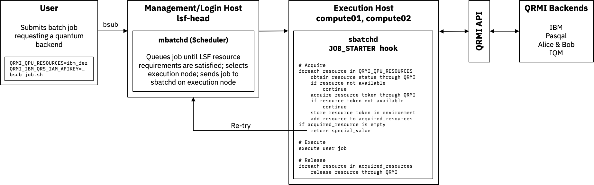

# Module 1: QRMI with LSF

This document describes how to install QRMI and the LSF hooks that manage quantum resources (QPUs) through QRMI on the LSF cluster containers described in [INSTALL.md](../../../containers/lsf/docs/INSTALL.md).

> [!NOTE]
> **Note for Podman users:** The commands below use the `docker` CLI. With Podman, replace `docker` with `podman` (for example `podman cp ...`, `podman exec -it lsf-head bash -l`), or define `alias docker=podman`. `docker compose` / `docker-compose` work with Podman as long as `docker-compose` is installed.

## Jump To

- [Overview](#overview)
- [Prerequisites](#prerequisites)
- [Installing the QRMI Hooks](#installing-the-qrmi-hooks)
  - [1. Installing QRMI](#1-installing-qrmi)
  - [2. Generating the QRMI configuration](#2-generating-the-qrmi-configuration)
  - [3. Registering the hooks](#3-registering-the-hooks)
  - [4. Verifying the installation](#4-verifying-the-installation)
- [Running QPU Jobs](#running-qpu-jobs)
  - [Using your own credentials](#using-your-own-credentials)
  - [Pasqal exercises](#pasqal-exercises)
  - [Switching provider](#switching-provider)
- [Checkpoint](#checkpoint)
- [Updating and Uninstalling](#updating-and-uninstalling)
- [Troubleshooting](#troubleshooting)
- [Notes and Limitations](#notes-and-limitations)

## Overview

Users request quantum resources through the `QRMI_QPU_RESOURCES` environment variable:

```bash
QRMI_QPU_RESOURCES=ibm_marrakesh bsub -Is job.sh
```

LSF follows the same pattern as the other workload managers ([One pattern, four workload managers](../../../README.md#3-one-pattern-four-workload-managers)), with fewer parts: there is no check at submission and no license or custom resource for the quantum resource; `JOB_STARTER` checks the resource when the job starts and requeues the job if it is not available. One hook (`JOB_STARTER`) handles the acquire-execute-release design pattern. The diagram below shows the flow of an LSF quantum job to an IBM Quantum Platform (IQP) system (`ibm_marrakesh`). The user submits the job with `bsub` and specifies a list of quantum resources in `QRMI_QPU_RESOURCES`. The `mbatchd` on `lsf-head` decides where to run the job and dispatches the job to an `sbatchd` on `compute01` or `compute02`. `sbatchd` starts the job through the `JOB_STARTER` hook described in more detail below.

<p align="center">
  
</p>

The `JOB_STARTER` hook expects `QRMI_QPU_RESOURCES` to be defined for quantum jobs. The site-wide `qrmi_config.json` contains only public information, so private values such as an IQP API key come from the user: either from `$HOME/.config/qrmi_config.json` or from an environment variable such as `QRMI_IBM_QCS_IAM_APIKEY`.

`JOB_STARTER` uses QRMI to obtain the status for each resource in `QRMI_QPU_RESOURCES`. If a resource is not available, it is skipped. If a resource is available, `JOB_STARTER` uses QRMI to obtain a token. If the `JOB_STARTER` is able to acquire resources, it places acquired resources and types in the `QRMI_JOB_QPU_RESOURCES` and `QRMI_JOB_QPU_TYPES` environment variables and executes the job. After execution `JOB_STARTER` releases all the acquired resources.

Pasqal Local (Warden) sessions can only be created by an administrator on behalf of the job's user, so they are acquired and released by a second hook, `pasqal_local.py`, which LSF runs as root before and after the job (`PRE_EXEC` / `POST_EXEC`). `JOB_STARTER` then only reads the prepared session. Because `POST_EXEC` runs even when LSF kills the job, Local sessions are always released.

If `JOB_STARTER` cannot acquire any available resources, it returns a special value to indicate to the scheduler to retry in the next scheduling cycle (every 5 seconds). The special value is defined by `REQUEUE_EXIT_VALUES`. The number of retries is defined by `MAX_JOB_REQUEUE`. Both are defined for the `normal` and `interactive` queues. After `MAX_JOB_REQUEUE` tries, the scheduler puts the job in `PSUSP` state. The job remains in the queue in `PSUSP` state until the user resumes it with `bresume <jobid>` or removes it with `bkill <jobid>`.

One disadvantage of this design is that `compute01` or `compute02` is assigned to run a quantum job which is not necessary. Because `JOB_STARTER` is lightweight, an alternate design is to define a "quantum" queue that runs jobs on `lsf-head`.

| File | Description |
|------|-------------|
| `hooks/jobstarter.qrmi` | `JOB_STARTER` hook that handles acquire-execute-release |
| `hooks/pasqal_local.py` | `PRE_EXEC` / `POST_EXEC` hook that acquires and releases Pasqal Local sessions as root |
| `containers/lsf/qrmi_config.json.example` | Template for the site-wide configuration (public values only) |
| `containers/lsf/qrmi_config.json.user.example` | Template for a user's private values (API keys) |

## Prerequisites

- The LSF cluster from [INSTALL.md](../../../containers/lsf/docs/INSTALL.md) is running (`lsf-head`, `compute01`, `compute02`), started with the add-ons of all vendors (`compose.ibm.yaml` for the local IBM Quantum System API emulator, `compose.warden.yaml` for the Pasqal Local Warden). Its first start installs LSF and, without the prebuilt MPICH archive, compiles MPICH, which took about an hour on a 2-core laptop, so start it before the session ([Building the containers](../../../containers/lsf/docs/INSTALL.md#1-building-the-containers)).
- QRMI 0.26.1 or later. It loads the MUNGE library at runtime, which Pasqal Local needs; the containers run `munged` with a key shared by all nodes and Warden.
- Your QPU provider, chosen during the onboarding:
  - **Pasqal:** Pasqal Cloud `EMU_FREE` with your own account ([Pasqal Cloud onboarding](../../../onboarding/pasqal-cloud-onboarding.md)), and Pasqal Local `PASQAL_LOCAL` through the local Warden as offline fallback.
  - **IBM:** The local IBM Quantum System API emulator `fake_brisbane` (no account needed), or IBM Quantum Platform with your own API key and service CRN ([IBM onboarding](../../../onboarding/ibm-quantum-onboarding.md)).

## Installing the QRMI Hooks

### 0. Go to the cluster directory

On the host, change to `containers/lsf` in the directory where you cloned the tutorial repository. The commands below run from there:

```bash
cd <path/to/clone_dir>/containers/lsf
```

### 1. Installing QRMI

The hooks use their own Python environment in `/opt/lsfce/pyenv`, which `compute01` and `compute02` see as well. The Pasqal Local hook runs as root and imports QRMI from this environment, so install it as root and keep it owned by root:

```bash
docker exec -u root lsf-head bash -c "python3 -m venv /opt/lsfce/pyenv && /opt/lsfce/pyenv/bin/pip install requests dotenv qrmi==0.26.4"
```

Verify the installation under the same conditions as the hooks (`-I` isolates Python from the user's environment and site directory):

```bash
for c in lsf-head compute01 compute02; do
    docker exec -u lsfuser $c /opt/lsfce/pyenv/bin/python3 -I -c 'import qrmi; print(qrmi.__file__)'
done
```

Each container should print `/opt/lsfce/pyenv/lib/python3.12/site-packages/qrmi/__init__.py`.

> QRMI installed this way is stored in the shared `/opt` volume. It survives `docker compose down` and `up`, but not `docker compose down -v`.

### 2. Generating the QRMI configuration

Each entry in `resources` defines one quantum resource that users can request by its `name`. The fields, the resource types and their settings are described in [QRMI_CONFIG.md](../QRMI_CONFIG.md).

Copy the template and keep the entries for your provider (you can delete the others):

```bash
cp qrmi_config.json.example qrmi_config.json
```

- **Pasqal:** keep `EMU_FREE` and `PASQAL_LOCAL`. They contain no credentials: `JOB_STARTER` forwards your `HOME`, so QRMI reads your own Pasqal Cloud account from `~/.pasqal/config`.
- **The local IBM Quantum System API emulator:** keep `fake_brisbane`. Its values point at the emulator started by `compose.ibm.yaml`.
- **IBM Quantum Platform:** keep or add an `ibm-quantum-compute-service` entry for your backend (for example `ibm_kingston`) with your service CRN. The API key does not go into this file.

Install the file for LSF. It must be readable by all users and writable only by root, because the Pasqal Local hook reads it as root:

```bash
docker cp qrmi_config.json lsf-head:/opt/lsfce/conf/qrmi_config.json
docker exec -u root lsf-head bash -c "chown root:root /opt/lsfce/conf/qrmi_config.json; chmod 644 /opt/lsfce/conf/qrmi_config.json"
```

**IBM Quantum Platform only:** put your API key into your own configuration file. Copy the template, keep the entry for your backend and fill in `QRMI_IBM_QCS_IAM_APIKEY`, then install it into your home directory, readable only by you:

```bash
cp qrmi_config.json.user.example qrmi_config.json.user
docker exec -u lsfuser lsf-head bash -c "mkdir -p ~/.config && chmod 700 ~/.config"
docker cp qrmi_config.json.user lsf-head:/home/lsfuser/.config/qrmi_config.json
docker exec -u root lsf-head bash -c "chown lsfuser:lsfuser /home/lsfuser/.config/qrmi_config.json; chmod 600 /home/lsfuser/.config/qrmi_config.json"
rm qrmi_config.json.user
```

Values in `~/.config/qrmi_config.json` override the site-wide file, and `QRMI_*` environment variables override both.

### 3. Registering the hooks

Copy both hooks, owned by root (the Pasqal Local hook runs as root, and `jobstarter.qrmi` imports from it):

```bash
docker exec -u root lsf-head mkdir -p /opt/lsfce/conf/hooks
docker cp ../../hands-on/module-1/lsf/hooks/jobstarter.qrmi lsf-head:/opt/lsfce/conf/hooks/jobstarter.qrmi
docker cp ../../hands-on/module-1/lsf/hooks/pasqal_local.py lsf-head:/opt/lsfce/conf/hooks/pasqal_local.py
docker exec -u root lsf-head bash -c "chown -R root:root /opt/lsfce/conf/hooks; chmod 755 /opt/lsfce/conf/hooks /opt/lsfce/conf/hooks/jobstarter.qrmi /opt/lsfce/conf/hooks/pasqal_local.py"
```

Configure the hooks for the `normal` and `interactive` queues and reconfigure LSF. `PRE_EXEC` and `POST_EXEC` are only used for Pasqal Local; for other resources they return immediately. The containers run them as root (`LSB_PRE_POST_EXEC_USER=root` in `/etc/lsf.sudoers`):

```bash
docker exec -u lsfuser lsf-head bash -c '
  q=/opt/lsfce/conf/lsbatch/cluster1/configdir/lsb.queues
  cp $q $q.orig
  for name in normal interactive; do
    sed -i "/^QUEUE_NAME   = $name\$/a JOB_STARTER  = /opt/lsfce/conf/hooks/jobstarter.qrmi\nPRE_EXEC     = /opt/lsfce/conf/hooks/pasqal_local.py acquire\nPOST_EXEC    = /opt/lsfce/conf/hooks/pasqal_local.py release\nREQUEUE_EXIT_VALUES = 99\nMAX_JOB_REQUEUE = 3" $q
  done
  source /opt/lsfce/conf/profile.lsf; badmin reconfig'
```

### 4. Verifying the installation

Check that the hooks are registered:

```bash
docker exec -u lsfuser lsf-head bash -c "source /opt/lsfce/conf/profile.lsf; bqueues -l normal interactive | grep -E 'JOB_STARTER|PRE_EXEC|POST_EXEC'"
```

You should see `JOB_STARTER`, `PRE_EXEC` and `POST_EXEC` once for each of the two queues. `badmin reconfig` restarts `mbatchd`; if nothing is printed, wait 10 seconds and run the command again.

Open a shell on the head node as `lsfuser`:

```bash
docker exec -it -u lsfuser -w /home/lsfuser lsf-head bash -l
```

A job without `QRMI_QPU_RESOURCES` defined runs as usual (the QRMI hooks do nothing for it):

```bash
bsub -Is hostname
```

Then run a QPU job for your provider. This helper submits a job for one resource and prints the job's QRMI variables, with secrets masked:

```bash
show() { QRMI_QPU_RESOURCES=$1 bsub -Is "env | grep -E '^(QRMI_|$1_)' | sed -E 's/(APIKEY|TOKEN|SECRET[A-Z_]*|PASSWORD)=.*/\1=********/' | sort"; }
```

- **Pasqal:** first write your account to `~/.pasqal/config` with the commands in [Pasqal Cloud onboarding, step 3](../../../onboarding/pasqal-cloud-onboarding.md#step-3-write-your-credentials-file) (mode 600; `/home` is shared, so the compute nodes see it). Then:

  ```bash
  show EMU_FREE
  show PASQAL_LOCAL
  ```

  For Pasqal Cloud, acquisition and release only check that the resource is online and do not use your credentials, so this job succeeds even with wrong credentials; they are first used when a program submits a task. Its output includes two expected QRMI warnings that acquiring and releasing are not implemented by `PasqalCloud`: Pasqal Cloud has no session to hold (`show fake_brisbane` prints the same pair for the local IBM Quantum System API emulator). For Pasqal Local, Warden logs the session the `PRE_EXEC` hook opened and the `POST_EXEC` hook revoked (on the host: `docker logs warden 2>&1 | grep /sessions`; the `DELETE` appears a few seconds after the job ends).

- **The local IBM Quantum System API emulator:**

  ```bash
  show fake_brisbane
  ```

- **IBM Quantum Platform:** the same with your backend name, for example `show ibm_kingston`.

The output should contain `QRMI_JOB_QPU_RESOURCES=<your resource>`, `<your resource>_QRMI_JOB_ACQUISITION_TOKEN` and the `<your resource>_QRMI_*` settings from the configuration.

## Running QPU Jobs

(Actual job execution will be covered starting in Module 2)

Environment variables available in the job:

| Variable | Description |
|----------|-------------|
| `QRMI_JOB_QPU_RESOURCES` | Acquired resource names, separated by `QRMI_LIST_DELIMITER` |
| `QRMI_JOB_QPU_TYPES` | Their resource types, in the same order |
| `QRMI_LIST_DELIMITER` | Delimiter of the lists above (`,`) |
| `<name>_QRMI_JOB_ACQUISITION_TOKEN` | Acquisition token of resource `<name>` |
| `<name>_<key>` | Settings of resource `<name>` from the configuration (for example `ibm_kingston_QRMI_IBM_QCS_ENDPOINT`) |

QRMI programs pick these up through `QRMIService`; they must not acquire or release the resources themselves. Debug messages are enabled with `LSF_QRMI_DEBUG=1`; they show the names of the variables that are set, never their values.

### Using your own credentials

Values from `~/.config/qrmi_config.json` (step 2) override the site-wide configuration. A `QRMI_*` variable in your environment overrides both, for one job:

```bash
QRMI_QPU_RESOURCES=ibm_kingston QRMI_IBM_QCS_IAM_APIKEY=<your API key> bsub -Is job.sh
```

Pasqal Cloud always uses your own `~/.pasqal/config`.

### Pasqal exercises

Continue with [Pasqal Module 2](../../module-2/pasqal/README.md#your-user-environment): set up your user environment there, then follow its LSF sections in Modules 2–4.

### Switching provider

To use another provider later, add its entries to `qrmi_config.json` and install the file again as in step 2. The hooks stay as they are. Pasqal Local needs the cluster to run with `compose.warden.yaml`, and the local IBM Quantum System API emulator needs `compose.ibm.yaml`.

## Checkpoint

Answer these before moving on:

1. **Where does the scheduler read `qrmi_config.json`?** From `/opt/lsfce/conf/qrmi_config.json` (no secrets, readable by all) and the user's own `~/.config/qrmi_config.json` (API keys, mode 600).
2. **Which component acquires and releases the quantum resource, and as which user?** `JOB_STARTER` (`jobstarter.qrmi`), as the job's user, for Pasqal Cloud and IBM; for Pasqal Local, the root `PRE_EXEC`/`POST_EXEC` hook (`pasqal_local.py`), because only an administrator may open a Warden session for the user.
3. **How does a job request a QPU?** With the `QRMI_QPU_RESOURCES=<name>` environment variable when submitting with `bsub`.

After Module 2, [Observe the integration](../OBSERVE.md) shows what these components do when a resource is busy, unavailable or cancelled.

## Updating and Uninstalling

**To update the hooks or the configuration**, copy the new files as in steps 2 and 3. Changes to `lsb.queues` need `badmin reconfig`.

**To remove the hooks**, restore the original queue configuration and reconfigure:

```bash
docker exec -u lsfuser lsf-head bash -c "q=/opt/lsfce/conf/lsbatch/cluster1/configdir/lsb.queues; cp \$q.orig \$q; source /opt/lsfce/conf/profile.lsf; badmin reconfig"
```

## Troubleshooting

- `bjobs -l <jobid>` and `bhist -l <jobid>` show why a job is pending, requeued (exit 99: no requested resource was available) or in `PSUSP` (after `MAX_JOB_REQUEUE` attempts).
- Run the job again with `LSF_QRMI_DEBUG=1` to see which resources the hook checked and which variables it set.
- **Pasqal Local:** a job that stays in `RUN` without output, with repeated `pre-exec command exited with non-zero status` entries in `bhist -l <jobid>`, means `PRE_EXEC` cannot open a Warden session; LSF retries it until it succeeds. Check that Warden answers (`docker exec lsf-head curl -fsS http://warden:4207/accessible`) and that `munged` runs on the compute nodes (`docker exec compute01 service munge status`). Warden's log shows the session requests (`docker logs warden`).
- **The local IBM Quantum System API emulator:** check that `docker ps` shows `qsa-sim` and the RustFS container (`lsf-rustfs-1`) running.

## Notes and Limitations

- `JOB_STARTER` releases the resources it acquired when the job ends, but cannot do so if it is killed with `SIGKILL`. Pasqal Local sessions are released by `POST_EXEC`, which runs in that case too.
- A quantum job occupies a slot on `compute01` or `compute02` while it runs.
