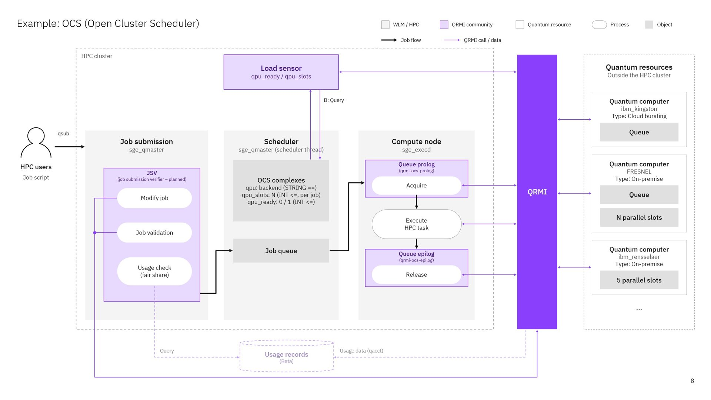

# Module 1: QRMI with Open Cluster Scheduler

Use Open Cluster Scheduler (OCS) to allocate a quantum resource from your chosen
provider, Pasqal or IBM, to a normal batch job. The prolog acquires the resource,
the application submits its quantum task, and the epilog releases the resource
when the job ends.

Allow about 15 minutes once the images are on your machine. Before the session,
build them as in the [OCS container guide](../../../containers/ocs/docs/INSTALL.md#1-building-the-containers),
including the tutorial images; this needs network access. After that, the
Pasqal Warden backup runs without network access.

**Participants:** complete the onboarding for your provider
([Pasqal Cloud](../../../onboarding/pasqal-cloud-onboarding.md) or
[IBM Quantum](../../../onboarding/ibm-quantum-onboarding.md)) and prepare the
images, then go to [step 1](#1-choose-your-qpu-provider) below. Definitions are in the
[terminology reference](../../GLOSSARY.md).

## What you install

<p align="center">
  
</p>

This module sets up the purple parts of the picture on `qpu.q` (step 4): the
queue **prolog** acquires the resource named by `-l qpu=<name>` before the job
starts and the **epilog** releases it. For the Pasqal Warden backup, a **load
sensor** reports `qpu_ready`, so OCS keeps jobs queued while Warden is
unavailable. The tutorial uses neither the planned JSV nor QPU slots. The
resources on the right are examples.

## 1. Choose your QPU provider

Set the cluster up for one provider. You keep it for the rest of the tutorial;
[Switching provider](#switching-provider) shows how to change later.

| Provider | Resource name | What you need |
| --- | --- | --- |
| Pasqal Cloud (default for Pasqal) | `EMU_FREE` | Your [Pasqal Cloud account](../../../onboarding/pasqal-cloud-onboarding.md) and network access |
| The local IBM Quantum System API emulator | `fake_brisbane` | Nothing else; no IBM account |
| IBM Quantum Platform | your backend, e.g. `ibm_kingston` | Your [IBM Quantum Platform account](../../../onboarding/ibm-quantum-onboarding.md) |

Pasqal participants also have Warden, a local simulator that serves as the
offline backup (`PASQAL_LOCAL`). The cluster starts with the add-ons of all
vendors from the images you built.

## 2. Start the cluster

On the host, in `containers/ocs`:

```bash
mkdir -p shared && chmod 777 shared

cp -r ../../hands-on shared/
```

Then start the cluster with the add-ons of all vendors:

```bash
docker compose -f compose.yaml -f compose.qrmi.yaml -f compose.warden.yaml -f compose.ibm.yaml up -d
until docker exec ocs-master curl -fsS http://warden:4207/accessible; do sleep 3; done
```

`compose.warden.yaml` adds the local Warden for Pasqal Local, and
`compose.ibm.yaml` the local IBM Quantum System API emulator. The last command ends
by printing `{"is_accessible":true,...}`; earlier `Connection refused` lines
while Warden starts are normal. To run fewer containers, leave out
`compose.ibm.yaml` or `compose.warden.yaml` (and the Warden check). Both start
only local backends: the IBM emulator for participants without an IBM account,
and Warden as Pasqal's offline backup. Jobs on IBM Quantum Platform or Pasqal
Cloud don't need them. Use the same `-f` list in every later `docker compose`
command.

The services need about 15 seconds to start. Check the nodes:

```bash
docker exec ocs-master bash -lc 'qhost; qstat -f'
```

Continue when both execution nodes are listed with a numeric load.

Use the [container installation guide](../../../containers/ocs/docs/INSTALL.md)
for Docker/Podman setup and MPI checks. With Podman, replace `docker` with
`podman` throughout. On Windows, run these commands in WSL and keep the source
in the Linux filesystem. Existing containers named `ocs-master`, `ocs-node1` or
`ocs-node2`, or another network using `172.31.0.0/24`, conflict with this setup.
Use a separate machine/VM or adjust names and network addresses consistently;
changing only the Compose project name does not change fixed container names.

## 3. Configure your provider

The two execution nodes share `/opt/ocs`. Store the administrator configuration
there so they read the same file. Its format is described in the
[QRMI configuration reference](../QRMI_CONFIG.md). Run the block for your
provider on the host.

**Pasqal.** The configuration defines `EMU_FREE` on Pasqal Cloud and
`PASQAL_LOCAL` on Warden at `http://warden:4207`:

```bash
docker exec ocs-master bash -lc '
  umask 077
  jq "{resources: ([.resources[] | select(.name == \"PASQAL_LOCAL\")]
        + [{name: \"EMU_FREE\", type: \"pasqal-cloud\",
            environment: {PASQAL_CONFIG_ROOT: \"/home/ocsuser\"}}])}" \
    /etc/qrmi/qrmi_config.json.example > /opt/ocs/qrmi-config.json
'
docker exec ocs-node1 install -m 644 \
  /etc/qrmi-ocs-load-sensor.yaml.example /etc/qrmi-ocs-load-sensor.yaml
```

`PASQAL_CONFIG_ROOT` tells QRMI to read `.pasqal/config` below that directory,
both in the root prolog and in your job, so your credentials stay in your own
file. The load sensor on `ocs-node1` reports whether Warden is available.

Create your credentials file as `ocsuser`:

```bash
docker exec -it -u ocsuser -w /home/ocsuser ocs-master bash -l
```

Inside the container, write `~/.pasqal/config` with the commands in
[Pasqal Cloud onboarding, step 3](../../../onboarding/pasqal-cloud-onboarding.md#step-3-write-your-credentials-file).
They prompt for your username, password and project ID and create the file with
mode 600. The listing at the end should start with `-rw-------`. Type `exit`.

**The local IBM Quantum System API emulator.** `compose.ibm.yaml` runs
[the local IBM Quantum System API emulator](https://github.com/qrmi-community/simulated_quantum_resource)
at `http://qsa-sim:8290`, with its S3 storage at `http://rustfs:9000`. It runs
circuits on Qiskit Aer with the configuration of IBM devices (`fake_lagos`,
`fake_cairo`, `fake_brisbane`, `fake_torino`); it is not the IBM service. The
resource name must be one of these backend names:

```bash
docker exec ocs-master bash -lc '
  umask 077
  jq "{resources: [.resources[] | select(.name == \"fake_brisbane\")]}" \
    /etc/qrmi/qrmi_config.json.example > /opt/ocs/qrmi-config.json
'
```

**IBM Quantum Platform.** Use the backend name, API key and instance CRN from
the [IBM onboarding guide](../../../onboarding/ibm-quantum-onboarding.md). Replace
the three placeholders, including the angle brackets:

```bash
docker exec ocs-master bash -lc '
  umask 077
  jq --arg name "<your backend>" --arg key "<your API key>" --arg crn "<your instance CRN>" \
    "{resources: [.resources[] | select(.name == \"ibm_kingstson\")
        | .name = \$name
        | .environment.QRMI_IBM_QCS_IAM_APIKEY = \$key
        | .environment.QRMI_IBM_QCS_SERVICE_CRN = \$crn]}" \
    /etc/qrmi/qrmi_config.json.example > /opt/ocs/qrmi-config.json
'
```

For all providers, check that QRMI is installed on the nodes:

```bash
docker exec ocs-node1 ldd /opt/qrmi/bin/libqrmi.so
docker exec ocs-node1 /opt/qrmi/venv/bin/python -c \
  'from qrmi import QRMIService; from qrmi.pulser import PulserQRMIConnection; import pulser; print(pulser.__version__)'
```

The library listing must include `libmunge.so.2`, and the last command prints
the Pulser version.

## 4. Connect OCS to QRMI

Keep `all.q` for classical jobs and create `qpu.q` for jobs requesting a quantum
resource. Jobs without a QPU request pass through the QRMI hooks unchanged, but a
separate queue keeps quantum and classical work apart. On the host, create the
queue once:

```bash
docker exec ocs-master bash -lc '
  qconf -sq all.q | sed "s/^qname .*/qname qpu.q/" > /tmp/qpu.q
  qconf -Aq /tmp/qpu.q
'
```

Then configure its hooks with your resource name. Pasqal, which also installs
the load sensor for the Warden backup:

```bash
docker exec ocs-master bash -lc '
  /opt/qrmi/bin/adapter setup-qrmi-support \
    --hosts ocs-node1,ocs-node2 --host-value EMU_FREE --queue qpu.q \
    --qrmi-config /opt/ocs/qrmi-config.json --qstat "$(command -v qstat)" \
    --prolog /opt/qrmi/bin/qrmi-ocs-prolog --epilog /opt/qrmi/bin/qrmi-ocs-epilog \
    --enable-load-sensor --load-sensor-host ocs-node1 \
    --load-sensor-path /opt/qrmi/bin/qrmi-ocs-load-sensor
  qconf -mattr queue slots 2 all.q@ocs-node1
  qconf -mattr queue slots 2 all.q@ocs-node2
  qconf -sq qpu.q
'
```

IBM (replace `fake_brisbane` with your backend name on IBM Quantum Platform):

```bash
docker exec ocs-master bash -lc '
  /opt/qrmi/bin/adapter setup-qrmi-support \
    --hosts ocs-node1,ocs-node2 --host-value fake_brisbane --queue qpu.q \
    --qrmi-config /opt/ocs/qrmi-config.json --qstat "$(command -v qstat)" \
    --prolog /opt/qrmi/bin/qrmi-ocs-prolog --epilog /opt/qrmi/bin/qrmi-ocs-epilog
  qconf -mattr queue slots 2 all.q@ocs-node1
  qconf -mattr queue slots 2 all.q@ocs-node2
  qconf -sq qpu.q
'
```

The commands can be repeated. The queue's prolog and epilog should begin with
`root@/opt/qrmi/bin/qrmi-ocs-launch`: OCS starts the hooks as its admin user
(root in these containers), through a launcher that gives them a clean
environment, so nothing a job sets with `qsub -v` or `-V` reaches them. Jobs
select the resource with `-l qpu=<resource>`. Each host advertises one resource
name at a time.

## 5. Submit as a regular user

On the host:

```bash
docker exec -it -u ocsuser -w /home/ocsuser ocs-master bash -l
```

Inside the container, copy the exercises and submit a job that requests your
resource (`EMU_FREE` for Pasqal, `fake_brisbane` or your IBM backend):

```bash
mkdir -p ~/hands-on
cp -r /shared/hands-on/. ~/hands-on/
QPU=EMU_FREE    # IBM: fake_brisbane, or your IBM backend
qsub -sync y -cwd -q qpu.q -l qpu=$QPU -b y /usr/bin/hostname
qacct -j <job-id>
```

Replace `<job-id>` with the number printed by `qsub`. Check `exit_status 0` and
the `qrmi_*` accounting fields: acquired count 1, release total 1, release
success 1 and release failed 0. `qrmi_epilog_status_code 1` also means success.
Accounting can take a few seconds to appear; if `qacct` reports that the job
is not found, wait five seconds and repeat it. If it lists several records
(job numbers can repeat after the containers are recreated), read the one with
`qname qpu.q`. This applies to every job in the modules.

The prolog checks that the resource is online and records the allocation; the
epilog records the release. Neither uses your credentials, so this job succeeds
even with wrong credentials. The job's error file contains two expected `WARN`
lines: a generated acquisition ID, and a release with nothing to release. With
Pasqal, two more appear if `~/.pasqal/config` does not exist yet. Leave the
container shell with `exit`.

**Without network access**, the status check can't reach a cloud provider: the
prolog asks OCS to reschedule the job, which waits in the queue (`qsub -sync y`
keeps waiting) and runs once the network is back. The queue stays usable. Stop a
waiting `qsub` with Ctrl-C and delete the job with `qdel <job-id>`. With Pasqal,
you can work offline: map `PASQAL_LOCAL` in step 4 (`--host-value PASQAL_LOCAL`)
and submit with `-l qpu=PASQAL_LOCAL,qpu_ready=1` instead.

## 6. Check your provider

Your credentials are first used when a program submits a quantum task.

**Pasqal.** Open a shell as `ocsuser` again and submit the Module 2 program. This
check uses the Python environment prepared in the image (`/opt/qrmi/venv`); you
create your own in [Pasqal Module 2](../../module-2/pasqal/README.md#your-user-environment).

```bash
docker exec -it -u ocsuser -w /home/ocsuser/hands-on/module-2/pasqal ocs-master bash -l
```

Inside the container:

```bash
/opt/qrmi/venv/bin/python make_sequence.py
qsub -sync y -l qpu=EMU_FREE -v PYENV=/opt/qrmi/venv -o cloud-check.out -e cloud-check.log \
  ../run_python.ocs qrmi_example.py bell.json --runs 100 --output cloud-check.json
cat cloud-check.json
```

Expect a `counter` with 100 shots. Pasqal Cloud may queue the task for a few
minutes. An authentication error in `cloud-check.log` means the username,
password or project ID in `~/.pasqal/config` is wrong. Then continue with
[Pasqal Module 2](../../module-2/pasqal/README.md).

**IBM.** Continue with [IBM Module 2](../../module-2/ibm/README.md); its first
scheduler job is the check.

### Pasqal: switch to the Warden backup

If Pasqal Cloud is unreachable or its queue is too slow for the session, use
Warden for the remaining modules. Wait for or cancel Cloud jobs, then run the
Pasqal command of step 4 again with `--host-value PASQAL_LOCAL`. Submit unchanged
programs with `-l qpu=PASQAL_LOCAL,qpu_ready=1`: `qpu_ready=1` asks OCS to wait
until Warden is available. Inspect the load sensor's current output:

```bash
docker exec ocs-node1 bash -lc \
  'printf "\nquit\n" | /opt/qrmi/bin/qrmi-ocs-load-sensor'
```

Expect a `global:qpu_ready:1` line between `begin` and `end`. OCS may need one
load-report interval before it schedules the first readiness-constrained job.
To return to Cloud, run the step 4 command with `--host-value EMU_FREE`.

## Checkpoint

Answer these before moving on:

1. **Where does the scheduler read `qrmi_config.json`?** From `/opt/ocs/qrmi-config.json` on the `/opt/ocs` volume that all nodes share, the path given to the hooks by `setup-qrmi-support`.
2. **Which component acquires and releases the quantum resource, and as which user?** The queue's prolog and epilog on the execution node, run as root (`root@` in the queue configuration), for the job's owner.
3. **How does a job request a QPU?** With `-l qpu=<name>` on `qpu.q` (the Pasqal Warden backup adds `qpu_ready=1`).

After Module 2, [Observe the integration](../OBSERVE.md) shows what these components do when a resource is busy, unavailable or cancelled.

## Switching provider

You are not expected to change provider during the tutorial. If you do, wait
for or cancel running jobs, then on the host, in `containers/ocs`:

1. If you left out the new provider's compose file in step 2, start the cluster
   with it added, for example all four files:

   ```bash
   docker compose -f compose.yaml -f compose.qrmi.yaml -f compose.warden.yaml -f compose.ibm.yaml up -d
   ```

   Use these files in every later `docker compose` command. Adding a compose
   file recreates the OCS containers. The scheduler settings and resource
   configuration persist, but the load-sensor config lives in the container.
   If you keep Warden, install it again and restart the node; otherwise
   `qpu_ready` stays 0 and Warden jobs wait in the queue:

   ```bash
   docker exec ocs-node1 install -m 644 \
     /etc/qrmi-ocs-load-sensor.yaml.example /etc/qrmi-ocs-load-sensor.yaml
   docker restart ocs-node1
   ```

2. Add the new provider's resource to the configuration, for example `fake_brisbane`:

   ```bash
   docker exec ocs-master bash -lc '
     umask 077
     jq ".resources += [input.resources[] | select(.name == \"fake_brisbane\")]" \
       /opt/ocs/qrmi-config.json /etc/qrmi/qrmi_config.json.example > /tmp/qrmi-config.json
     mv /tmp/qrmi-config.json /opt/ocs/qrmi-config.json
   '
   ```

3. Run the step 4 command for the new provider with its resource name.

## Recovery

Use `qstat -j <job-id>` for queued jobs and `qacct -j <job-id>` after completion.
The QRMI prolog does nothing for jobs without a QPU request (exit 0) and reports
problems through its exit code:

- **99:** the resource is temporarily unavailable (for example the provider's
  cloud service is unreachable, or Warden is down). OCS reschedules the job, which
  runs once the resource is back. The queue stays usable.
- **100:** the job's request can't be served (an invalid `qpu` request such as a
  wildcard or a soft request, a resource that isn't in the configuration, or a
  job submitted with dynamic-loader variables such as `LD_PRELOAD`). The job goes
  into error state (`Eqw`); `qstat -j <job-id>` shows the reason. Fix the request
  and delete the job (`qdel`), or clear its error with `qmod -cj <job-id>`.
- **Other codes** point to a problem on the host and put the queue instance into
  error state (`E` in `qstat -f`). `qstat -explain E -q qpu.q` shows why, and the
  prolog's own message is in the job's error (`-e`) file. The execution node's
  log, `/opt/ocs/default/spool/<hostname>/messages`, has more detail. Fix the
  cause, then use `qmod -c qpu.q@<hostname>` to clear the error.

For a break, stop and start the cluster with the same `-f` list as the start
command (`docker compose -f ... stop`, then `start`). If the containers were
removed with `down`, install the load-sensor configuration of step 3 on
`ocs-node1` again and run `docker restart ocs-node1`: that file lives in the
container. The resource configuration and scheduler settings persist in the
`ocs-root` volume, and Warden's database in `warden-state`. `down -v` deletes
them, along with the MUNGE key and the home directories.
