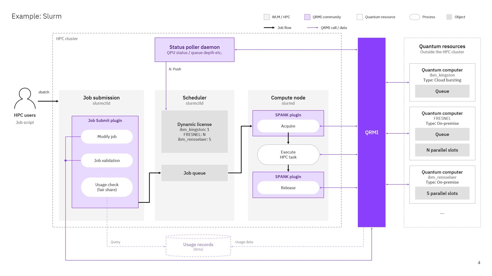
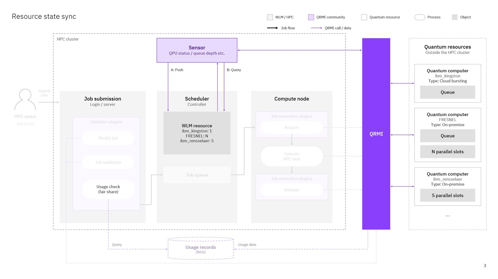

# Module 1: QRMI with Slurm

> [!NOTE]
> **Note for Podman users:** The commands below use the `docker` CLI. With Podman, replace `docker` with `podman` (for example `podman cp ...`, `podman exec -it slurmctld bash -l`), or define `alias docker=podman`. `docker compose` / `docker-compose` work with Podman as long as `docker-compose` is installed.

This guide uses `ibm_kingston` as the example backend name. If you don't have an IBM account and are using the local IBM Quantum System API emulator, replace `ibm_kingston` with `fake_brisbane` throughout. If you chose Pasqal or Alice & Bob, follow the **If you chose Pasqal** or **If you chose Alice & Bob** notes in the steps where the setup differs.

## What you install

<p align="center">
  
</p>

This module installs the purple parts of the picture, each a step below:

- the **QRMI SPANK plugin** (steps 7–9): on the compute node, it acquires the quantum resource named by `--qpu` before the job's program starts and releases it when the job ends;
- the **license poller daemon** (steps 10–17): it keeps one Slurm license per quantum resource in line with what QRMI reports, so Slurm holds a job (`PENDING (Licenses)`) instead of starting it while the resource is busy;
- the **job submit plugin** (steps 18–20): at `sbatch`, it rejects a job whose `--qpu` has no matching `--licenses`.

`qrmi_config.json` (steps 3–4) defines the resources all three use. The resources on the right of the picture are examples; your job uses the provider you choose below.

You work in four shells; each step says which:

| Shell | Open it with | User | Used for |
| --- | --- | --- | --- |
| Host | your terminal, in `containers/slurm` | you | `docker` commands (steps 1–4) |
| `slurmctld` | `docker exec -it slurmctld bash -l` | `root` | installing the plugins and licenses (steps 5–20) |
| Login node, administrator | `docker exec -it login bash -l` | `root` | the verification job (steps 21–23) |
| Login node, user | `docker exec -it -u user -w /home/user login bash` | `user` | provider credentials and Modules 2–4 |

## Choose your QPU provider

Use the resources of one provider throughout Modules 1–3:

- **IBM:** your backend on IBM Quantum Platform, from the [IBM Quantum onboarding](../../../onboarding/ibm-quantum-onboarding.md), or the local IBM Quantum System API emulator `fake_brisbane` if you have no IBM account.
- **Pasqal:** `EMU_FREE` on Pasqal Cloud, with your own account from the [Pasqal Cloud onboarding](../../../onboarding/pasqal-cloud-onboarding.md), and `PASQAL_LOCAL`, the local Warden backup that needs no network.
- **Alice & Bob:** `ab_emu_1q_lescanne_2020` and `ab_emu_6q_physical_cats`, cat-qubit emulators on Felis, with the tutorial key from the [Alice & Bob onboarding](../../../onboarding/alice-bob.md).

## Starting the Slurm cluster

1. Change to the `containers/slurm` directory inside the directory where you cloned the tutorial repository.

   ```bash
   cd <path/to/clone_dir>/containers/slurm
   ```

2. Start the Slurm Docker cluster with the add-ons of all vendors.

   ```bash
   docker compose build
   docker compose -f compose.yml -f compose.ibm.yml -f compose.warden.yml up -d --build
   ```

   Run both commands. The first builds the Slurm image (skip it if you built it in the container guide), the second builds the add-ons' images and starts the cluster. With Podman, set the build variables from the [Podman note](../../../containers/slurm/docs/INSTALL.md#prerequisites) first (`export DOCKER_BUILDKIT=0 COMPOSE_DOCKER_CLI_BUILD=0 COMPOSE_BAKE=false`).

   `compose.ibm.yml` adds the local IBM Quantum System API emulator (`fake_brisbane`). `compose.warden.yml` adds a local Warden for Pasqal Local.

   To run fewer containers, leave out `compose.ibm.yml` or `compose.warden.yml`. Both start only local backends: the IBM emulator for participants without an IBM account, and Warden as Pasqal's offline backup. Jobs on IBM Quantum Platform or Pasqal Cloud don't need them. Use the same `-f` list in every later `docker compose` command.

   **If you chose Alice & Bob**, the Alice & Bob resources need no add-on: they run on Felis, Alice & Bob's cloud service. To run only the Alice & Bob exercises, start the cluster without the add-ons, which also means you don't need the Pasqal images, and use `-f compose.yml` alone in every later `docker compose` command:

   ```bash
   docker compose -f compose.yml up -d --build
   ```

3. Create `qrmi_config.json` by copying the provided template, `qrmi_config.json.example`. The [QRMI configuration reference](../QRMI_CONFIG.md) describes its fields and resource types.

   ```bash
   cp qrmi_config.json.example qrmi_config.json
   ```

   - **If you don't have an IBM account**, no changes are needed. The file already defines the local emulator, `fake_brisbane`.
   - **If you created an IBM account during the onboarding step** and have access to an IBM Quantum backend, fill in the `ibm_kingston` entry that the template already has:

   ```json
   {
     "name": "ibm_kingston",
     "type": "ibm-quantum-compute-service",
     "environment": {
       "QRMI_IBM_QCS_ENDPOINT": "https://quantum.cloud.ibm.com/api/v1",
       "QRMI_IBM_QCS_IAM_ENDPOINT": "https://iam.cloud.ibm.com",
       "QRMI_IBM_QCS_SESSION_MODE": "batch",
       "QRMI_IBM_QCS_IAM_APIKEY": "<YOUR IAM APIKEY FOR THIS BACKEND>",
       "QRMI_IBM_QCS_SERVICE_CRN": "<YOUR IQP INSTANCE CRN>"
     }
   }
   ```

   Replace the two placeholders with your values. If your backend is not `ibm_kingston`, change `name` to your backend's name. The entry's `name` is the resource name you use in all the following steps.
   - **If you chose Pasqal**, no changes are needed: the file already defines `EMU_FREE` (Pasqal Cloud) and `PASQAL_LOCAL` (the Warden of `compose.warden.yml`). Pasqal Cloud reads your own account from `/home/user/.pasqal/config` (`PASQAL_CONFIG_ROOT`), so no credentials go into this file. Create the account as described in the [Pasqal Cloud onboarding guide](../../../onboarding/pasqal-cloud-onboarding.md); write `~/.pasqal/config` with the commands in [Pasqal Cloud onboarding, step 3](../../../onboarding/pasqal-cloud-onboarding.md#step-3-write-your-credentials-file), inside the login node as `user`. On the host, open that shell with `docker exec -it -u user -w /home/user login bash`; `/home` is shared, so the compute nodes see the file.
   - **If you chose Alice & Bob**, fill in the two entries the file already defines: `ab_emu_1q_lescanne_2020`, used in Module 2, and `ab_emu_6q_physical_cats`, used in Module 3. In both, replace `<FELIS URL>` and `<FELIS API KEY>` with the respective values obtained from the [Alice & Bob onboarding](../../../onboarding/alice-bob.md).

4. Copy the file into the container.

   ```bash
   docker cp qrmi_config.json slurmctld:/etc/slurm/qrmi_config.json
   docker exec slurmctld bash -c 'chown root:root /etc/slurm/qrmi_config.json && chmod 600 /etc/slurm/qrmi_config.json'
   ```

   The file can hold API keys, and `/etc/slurm` is also mounted on the login node, so only root may read it. The SPANK plugin reads it as root on the compute nodes.

5. Log in to the `slurmctld` node container.

   ```bash
   docker exec -it slurmctld bash -l
   ```

6. Change to the shared volume, `/shared`.

   ```bash
   cd /shared/
   ```

## Building and setting up the QRMI SPANK plugin

7. Clone the `spank-plugins` repository.

   ```bash
   git clone https://github.com/qiskit-community/spank-plugins.git
   git -C spank-plugins checkout 3455388   # the commit this tutorial was tested with
   ```

8. Build the plugin.

   ```bash
   cd spank-plugins/plugins/spank_qrmi/
   mkdir build
   cd build
   cmake -DQRMI_GIT_TAG=0.26.4 ..   # build against the QRMI release used in this tutorial
   make
   ```

   The plugin is built as `/shared/spank-plugins/plugins/spank_qrmi/build/spank_qrmi.so`.

   `make` downloads and compiles QRMI, which is written in Rust, with the Rust version QRMI requires. This is the largest download of the session and is slow on small machines (about 12 minutes on a 2-core laptop). Let it finish.

   You can do steps 5–8 before the session: they only download and compile into `/shared`, which is kept on the host; nothing is registered with Slurm until step 9. If you did, skip steps 7–8 in the session and continue with step 9.

9. Register the plugin with Slurm. A sample configuration file, `/etc/slurm/plugstack.conf.example`, is already provided. Make sure the plugin path in the file points to the `spank_qrmi.so` you built in the previous step, and that the config path is `/etc/slurm/qrmi_config.json`. Then copy it:

   ```bash
   cat /etc/slurm/plugstack.conf.example
   cp /etc/slurm/plugstack.conf.example /etc/slurm/plugstack.conf
   ```

The SPANK plugin setup is now complete.

## Setting up the Slurm license poller daemon

The Slurm license poller daemon updates Slurm dynamic license counts based on the current status of quantum resources, as reported by [QRMI](https://github.com/qiskit-community/qrmi) (Quantum Resource Management Interface).

It provides a reference implementation of the Sensor pattern: the state of a quantum system is monitored and fed into Slurm's scheduling decisions through [Slurm's Dynamic License mechanism](https://slurm.schedmd.com/licenses.html#dynamic_licenses). This demonstrates how Slurm scheduling can be coordinated with external quantum resource availability — when a quantum backend is occupied by another user, Slurm keeps the job in the `PENDING` state instead of allocating compute resources that would otherwise sit idle while waiting for quantum execution.

Any resource type supported by QRMI can be monitored (e.g. IBM Quantum Compute Service, IBM Quantum System Service, Pasqal Cloud, IQM Server); the resources themselves are defined in a QRMI config file.

The daemon pushes the state to Slurm (path A below); other workload managers have the scheduler query a sensor instead (path B):

<p align="center">
  
</p>

For more details, refer to the [Slurm license poller daemon README](https://github.com/qrmi-community/slurm_poller_daemon_example/blob/main/README.md).

10. Clone the Slurm license poller daemon repository.

    ```bash
    cd /shared
    git clone https://github.com/qrmi-community/slurm_poller_daemon_example.git
    git -C slurm_poller_daemon_example checkout 31803a4   # the commit this tutorial was tested with
    ```

11. Create the Python virtual environment required to run the license poller daemon, and install the daemon into it.

    ```bash
    python3.12 -m venv /shared/poller_daemon_venv
    source /shared/poller_daemon_venv/bin/activate
    pip install --upgrade pip
    cd /shared/slurm_poller_daemon_example/poller
    pip install . qrmi==0.26.4   # the QRMI release used in this tutorial
    ```

12. Create the configuration file.

    ```bash
    cd /shared/slurm_poller_daemon_example/poller
    cp config.json.example config.json
    ```

    Write `config.json`, listing in `resources` the resource names you defined in `qrmi_config.json` in step 3 (this replaces the template's example entries, such as `test_heron`). If you don't have an IBM account, write `fake_brisbane` instead of `ibm_kingston` to use the local emulator. To monitor several providers, list them all, for example `["fake_brisbane", "EMU_FREE"]`:

    ```bash
    cat > config.json << 'EOF'
    {
      "config_path": "/etc/slurm/qrmi_config.json",
      "resources": ["ibm_kingston"],
      "poll_interval": 60,
      "failure_threshold": 3,
      "resync_interval": 300,
      "sacctmgr_timeout": 30
    }
    EOF
    ```

    **If you chose Pasqal**, list `"EMU_FREE"` in `resources`:

    ```bash
    cat > config.json << 'EOF'
    {
      "config_path": "/etc/slurm/qrmi_config.json",
      "resources": ["EMU_FREE"],
      "poll_interval": 60,
      "failure_threshold": 3,
      "resync_interval": 300,
      "sacctmgr_timeout": 30
    }
    EOF
    ```

    Do not list `PASQAL_LOCAL`: the daemon cannot check it outside a job and stops at startup. Warden queues jobs itself, so `PASQAL_LOCAL` gets a fixed license instead (step 14). A warning in the daemon's log that `/home/user/.pasqal/config` does not exist is harmless: checking whether `EMU_FREE` is online needs no credentials.

    **If you chose Alice & Bob**, list `"ab_emu_1q_lescanne_2020"` and `"ab_emu_6q_physical_cats"` in `resources`.

13. Add a license resource to Slurm that represents the status of this backend. The license name must be identical to the resource name in `qrmi_config.json` and `config.json`. **If you chose Pasqal or Alice & Bob**, skip this step: step 14 creates your licenses.

    `sacctmgr -i` commits without asking:

    ```bash
    sacctmgr -i add resource name=ibm_kingston count=1 cluster=linux allowed=100 type=license
    ```

    It prints the resource it adds:

    ```
     Adding Resource(s)
      ibm_kingston@slurmdb
       Cluster - linux 100
     Settings
      Name           = ibm_kingston
      Server         = slurmdb
      Description    = ibm_kingston
      Count          = 1
      Type           = License
    ```

14. Set the initial value of the license resource. Setting `lastconsumed=1` marks the license as in use, so that no job can run against the backend until the license poller daemon has confirmed that the backend is ready.

    ```bash
    sacctmgr -i update resource ibm_kingston set lastconsumed=1
    ```

    **If you chose Pasqal**, create both licenses. Slurm stores license names in lowercase (`emu_free@slurmdb`, `pasqal_local@slurmdb`). `emu_free` starts as consumed, like above, until the daemon confirms `EMU_FREE` is online; `pasqal_local` is free from the start because no daemon manages it.

    ```bash
    sacctmgr -i add resource name=emu_free count=1 cluster=linux allowed=100 type=license
    sacctmgr -i update resource emu_free set lastconsumed=1
    sacctmgr -i add resource name=pasqal_local count=1 cluster=linux allowed=100 type=license
    sacctmgr -i update resource pasqal_local set lastconsumed=0
    ```

    **If you chose Alice & Bob**, create and initialize both licenses:

    ```bash
    for r in ab_emu_1q_lescanne_2020 ab_emu_6q_physical_cats; do
      sacctmgr -i add resource name=$r count=1 cluster=linux allowed=100 type=license
      sacctmgr -i update resource $r set lastconsumed=1
    done
    ```

15. Verify the license resource you created.

    ```bash
    scontrol show license
    ```

    `LastConsumed=1` and `Free=0` show that the license is currently unavailable:

    ```
    LicenseName=ibm_kingston@slurmdb
        Total=1 Used=0 Free=0 Reserved=0 Remote=yes
        LastConsumed=1 LastDeficit=1 LastUpdate=2026-10-21T00:23:01
    ```

    ```bash
    sacctmgr show resource withcluster format=name%20,server,type,count,lastconsumed,allocated,cluster,allowed
    ```

    ```
                    Name     Server     Type  Count LastConsumed Allocated    Cluster  Allowed
    -------------------- ---------- -------- ------ ------------ --------- ---------- --------
            ibm_kingston    slurmdb  License      1            1       100      linux      100
    ```

16. Start the Slurm license poller daemon in the background. Its log is written to `poller.log`.

    ```bash
    source /shared/poller_daemon_venv/bin/activate   # again, if you are in a new shell since step 11
    cd /shared/slurm_poller_daemon_example/poller
    nohup slurm-license-poller --config /shared/slurm_poller_daemon_example/poller/config.json > poller.log 2>&1 &
    ```

    On its first poll, the daemon releases the license if the backend is ready. You can confirm this with `scontrol show license`: `LastConsumed` changes to `0` and `Free` changes to `1`.

    The daemon does not survive a restart of the containers (`docker compose stop`/`start`, `restart`, or `down`/`up`): the licenses keep their last value and are no longer updated. After a restart, log in to `slurmctld` again and start it once more:

    ```bash
    source /shared/poller_daemon_venv/bin/activate
    cd /shared/slurm_poller_daemon_example/poller
    nohup slurm-license-poller --config /shared/slurm_poller_daemon_example/poller/config.json > poller.log 2>&1 &
    ```

    To change the monitored resources later (for example to add another provider), stop the daemon with `pkill -f 'bin/slurm-license-poller'`, edit `config.json`, create the license as in steps 13–14, and start the daemon again as above.

17. Deactivate the virtual environment. The daemon keeps running in the background.

    ```bash
    deactivate
    ```

## Setting up the job submit plugin

The license mechanism only works if users request the license with `--licenses` when they submit a job. The job submit plugin checks, at submission time, whether a job that specifies `--qpu` also requests the matching license. If it doesn't, the plugin rejects the job with an error asking the user to add the `--licenses` option.

18. Copy the job submit plugin to the Slurm configuration directory.

    ```bash
    cd /shared/slurm_poller_daemon_example/plugins
    cp job_submit.lua /etc/slurm/
    ```

    The plugin requires the license `<--qpu value in lowercase>@slurmdb`, because Slurm stores license names in lowercase.

19. Enable the plugin by adding the following line to `/etc/slurm/slurm.conf`:

    ```
    JobSubmitPlugins=lua
    ```

    For example, you can append it with:

    ```bash
    echo "JobSubmitPlugins=lua" >> /etc/slurm/slurm.conf
    ```

20. Apply the configuration change.

    ```bash
    scontrol reconfigure
    ```

## Verifying the setup

21. On the host, open another shell and log in to the login node.

    ```bash
    docker exec -it login bash -l
    ```

22. Create a job script, `verify_setup.slurm`, in `/shared` to verify the setup. Replace the quantum resource name specified in `--qpu` and `--licenses` with the name of the backend you are using.

    ```bash
    cd /shared
    cat > verify_setup.slurm << 'EOF'
    #!/bin/bash

    #SBATCH --job-name=verify_setup
    #SBATCH --ntasks=1
    #SBATCH --cpus-per-task=1
    #SBATCH --qpu=ibm_kingston
    #SBATCH --licenses=ibm_kingston@slurmdb:1

    # Your script goes here
    echo Hello
    EOF
    ```

    **If you chose Pasqal**, create this script instead; the license name is the resource name in lowercase:

    ```bash
    cd /shared
    cat > verify_setup.slurm << 'EOF'
    #!/bin/bash

    #SBATCH --job-name=verify_setup
    #SBATCH --ntasks=1
    #SBATCH --cpus-per-task=1
    #SBATCH --qpu=EMU_FREE
    #SBATCH --licenses=emu_free@slurmdb:1

    echo Hello
    EOF
    ```

    To check the Warden backup as well, submit the same script with `sbatch --qpu=PASQAL_LOCAL --licenses=pasqal_local@slurmdb:1 verify_setup.slurm` in step 23: options on the command line override the `#SBATCH` lines.

    **If you chose Alice & Bob**, use these two lines in the script instead:

    ```bash
    #SBATCH --qpu=ab_emu_1q_lescanne_2020
    #SBATCH --licenses=ab_emu_1q_lescanne_2020@slurmdb:1
    echo Hello
    ```


23. Submit the job.

    ```bash
    sbatch verify_setup.slurm
    ```

    When the job finishes, a `slurm-<JOB_ID>.out` file is created in `/shared`. If it contains `Hello`, the setup is complete. For the IBM emulator, `EMU_FREE` and Alice & Bob, the output also ends with a QRMI warning that releasing the resource is a no-op: these resources need no lock.

    For Pasqal, this job does not check your Pasqal Cloud credentials (if `~/.pasqal/config` is missing, the output warns that no config file was found); the first task in [Pasqal Module 2](../../module-2/pasqal/README.md#slurm) does.

    ```bash
    cat slurm-<JOB_ID>.out
    ```

### Troubleshooting

If `sbatch` fails with an error such as `--qpu=ibm_kingston requires --licenses to include ibm_kingston@slurmdb`, the job was rejected by the job submit plugin. Add the `--licenses` option that matches the `--qpu` value to the job script.

If the job stays in the `PENDING` state, check the following:

- Run `squeue` to see the job status and the reason it is pending. `(Licenses)` means the job is waiting for the license.
- Run `scontrol show license` and check `Free`. If it is `0`, the backend is busy or the license poller daemon has not released the license.
- Check `/shared/slurm_poller_daemon_example/poller/poller.log` for errors, such as authentication or network failures when retrieving the backend status.

## Checkpoint

Answer these before moving on:

1. **Where does the scheduler read `qrmi_config.json`?** From `/etc/slurm/qrmi_config.json`, the path given to the SPANK plugin in `/etc/slurm/plugstack.conf`.
2. **Which component acquires and releases the quantum resource, and as which user?** The QRMI SPANK plugin, inside Slurm's job step as root, before the job's program starts and after it ends.
3. **How does a job request a QPU?** With `--qpu=<name>` and the matching license, `--licenses=<name in lowercase>@slurmdb:1`; the job submit plugin rejects a job without it.

After Module 2, [Observe the integration](../OBSERVE.md) shows what these components do when a resource is busy, unavailable or cancelled.
