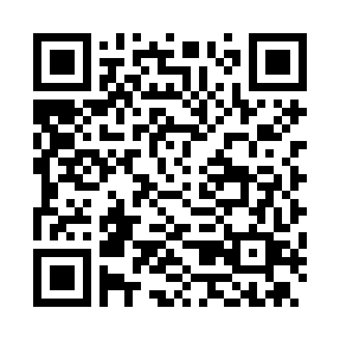

# Alice & Bob Onboarding Guide

The tutorial's Alice & Bob exercises run on emulators of cat qubits, through
Alice & Bob's Felis API. They use an API key provided for the tutorial, so there
is no account to create.

## Get the API key

You can find the Felis API key for the QRMI SC26 tutorial [here](https://gist.github.com/machjn/6f410ede883266e0de9fd9fc89c19be5), or
by scanning this QR code:

You write it into the Slurm cluster's `qrmi_config.json` in
[Slurm Module 1](../hands-on/module-1/slurm/INSTALL.md), and optionally into a
`.env` file for the `felis` command-line client in
[Alice & Bob Module 2](../hands-on/module-2/alice-bob/README.md).
